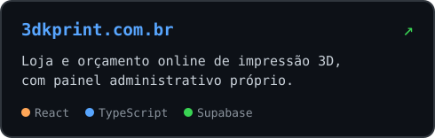
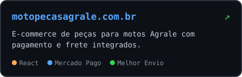
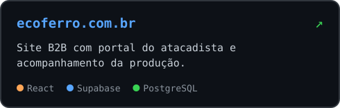
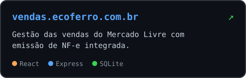
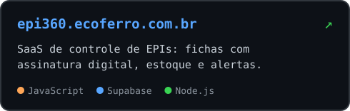
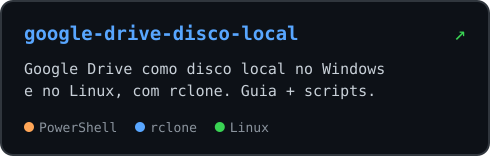

<!-- ============ $ ./perfil.sh ============ -->
<p align="center">
  
</p>

<p align="center">
  <a href="https://3dkprint.com.br"></a>
  
  
</p>

<br/>


[](https://git.io/typing-svg)

Desenvolvo sistemas **Full Stack** para negócios reais: lojas online, painéis de gestão, integrações com **Mercado Livre**, **Mercado Pago** e **Melhor Envio**, e automações com **Inteligência Artificial**.

Fora da tela, trabalho com **CAD 3D** e **impressão 3D**: escaneio peças de moto, refaço o modelo no `Fusion 360`, imprimo e coloco à venda. É o código ganhando forma no mundo físico.

No dia a dia uso `TypeScript`, `React`, `Node.js`, `Supabase/PostgreSQL` e `Python`.

```diff
+ Construindo sistemas web para indústria e e-commerce
+ Modelando peças no Fusion 360 e imprimindo em 3D
+ Automatizando processos com IA
- Peça que sai torta da impressora (trabalhando nisso)
```

<br/>


<p align="center">
  
</p>

<p align="center">
  
  
  
  
</p>

<br/>


<p align="center">
  <a href="https://3dkprint.com.br"></a>
  <a href="https://motopecasagrale.com.br"></a>
  <a href="https://ecoferro.com.br"></a>
  <a href="https://vendas.ecoferro.com.br"></a>
  <a href="https://epi360.ecoferro.com.br"></a>
  <a href="https://github.com/kustermarcio789/google-drive-disco-local"></a>
</p>

<br/>


<p align="center">
  
</p>

<picture>
  <source media="(prefers-color-scheme: dark)" srcset="https://raw.githubusercontent.com/kustermarcio789/kustermarcio789/output/github-snake-dark.svg" />
  <source media="(prefers-color-scheme: light)" srcset="https://raw.githubusercontent.com/kustermarcio789/kustermarcio789/output/github-snake.svg" />
  
</picture>

<p align="center">
  
</p>
